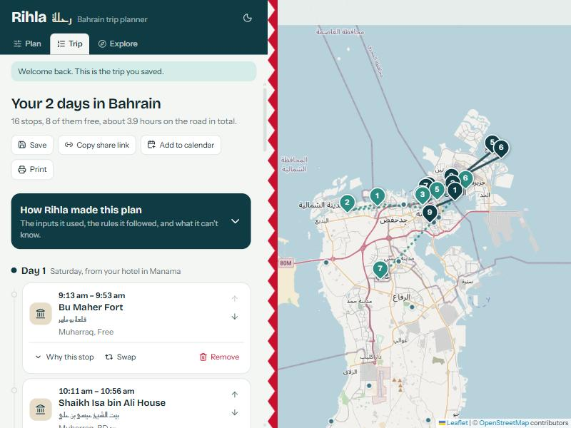
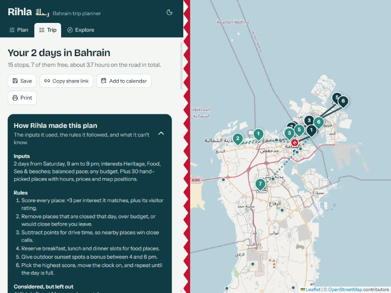
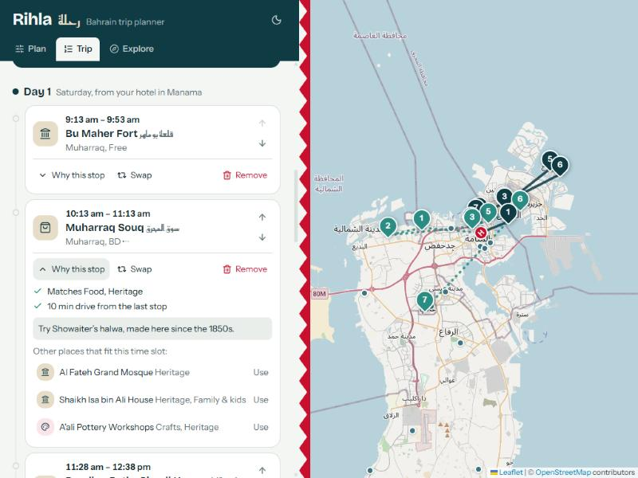

# Rihla · رحلة

**A Bahrain trip planner that shows its working.** Describe your trip in your own words. Rihla turns that into settings you can check, plans a timed itinerary around opening hours and drive times, draws it on a live map, and explains every stop it picked and every place it left out.

Built with Claude for the Bahrain Polytechnic **AI Literacy** course (Week 9, Session 16: *"Use Claude to create an app. Publish the code and share the link."*).



| Phone | How it decided | Why this stop and Swap |
| --- | --- | --- |
|  |  |  |

## Features

- **Plain-language input.** Type something like *"weekend with my kids, history, beaches, cheap please"*. Rihla shows what it understood and which words it understood it from, e.g. *Low budget from "cheap"*. You can then correct anything in the settings.
- **A real planner, not a fixed list.** It scores 30 hand-picked places against your interests, budget, pace, start day and hours. It skips places that are closed that day, keeps each day in one part of the island, reserves breakfast, lunch and dinner slots for food stops, and times outdoor spots for the late-afternoon light.
- **Explainable by design.** Every stop has a *Why this stop* list, such as *Matches Heritage, Crafts* or *10 min drive from the last stop*. The *How Rihla made this plan* panel shows the inputs, the six rules, the places it considered but left out (such as *Beit Al Quran: closed on Saturdays*), and what it can't know.
- **Edit and it re-times itself.** Move stops up or down, remove them, or swap one for a nearby alternative that fits the same time slot. If an edit breaks something, such as arriving after closing, you get a warning instead of a silent fix.
- **Live map.** OpenStreetMap with numbered pins and a route line for each day. Clicking a pin or a stop flies the map to it.
- **Explore 30 places.** Search and filter by interest. Each place has hours, typical visit length, entry cost, a local tip, its Arabic name and a directions link.
- **Keep and share.** Save the trip on your device, copy a share link (the whole trip is encoded in the URL, with no account or server), add it to your calendar as an `.ics` file, or print it.
- **Made for Bahrain.** Bilingual place names, the serrated edge from the Bahraini flag as the signature detail, light and dark themes, and a mobile layout with a full-screen map tab.

## How it meets the brief

| Brief | What was done |
| --- | --- |
| Use Claude to create an app | The whole app (idea, design system, planning engine, UI, tests and this README) was built with Claude in Claude Code. |
| Publish the code | Public GitHub repository (link below). |
| Share the link in the Blog Page | Live site on GitHub Pages (link below). A ready-to-paste blog paragraph and Teams post are in [`docs/BLOG.md`](docs/BLOG.md). |
| AI Literacy theme | The app treats planning as **inputs → rules → output** and shows all three. It also lists what the system *can't* know (live traffic, today's exact hours, your mood). That is the critical-thinking point from the course's "inputs and outputs" activity. |

**Live app:** _added after publishing_
**Code:** _added after publishing_

## How the planner works

1. **Inputs:** days, first weekday, start and end time, interests, pace, budget, kids, and meals. These come from the form or from the sentence parser in `src/lib/parse.ts`.
2. **Score** each place: +3 per matching interest, plus its visitor rating, plus a bonus for free places on a tight budget.
3. **Filter** out places that are closed that weekday, over budget, would close before you leave, or would run past your day.
4. **Penalise** drive time (an estimate from straight-line distance × 1.35 at about 38 km/h, plus parking) and crossing to another part of the island.
5. **Slots:** breakfast, lunch and dinner go to food places; outdoor sunset spots get a bonus between 4 and 6 pm.
6. **Greedy loop:** take the best-scoring stop, move the clock forward, and repeat until the pace limit is reached or the day ends.

It runs entirely in the browser, with no API key or server. That keeps it free to host, fast, and private, and makes every decision traceable. This is a deliberate AI-literacy choice: the "intelligence" here is transparent rules over curated data, and the app says so.

## Tech

React 19 · TypeScript · Vite · Tailwind CSS v4 · Leaflet / react-leaflet with OpenStreetMap tiles · lucide icons · self-hosted fonts (Bricolage Grotesque, Instrument Sans, Reem Kufi).

```
src/
  data/places.ts        30 curated places: coordinates, hours, cost, tags, tips, Arabic names
  lib/planner.ts        scoring, scheduling, re-timing, swap suggestions, explanations
  lib/parse.ts          plain-language request → settings, with evidence
  lib/share.ts          save, share links, calendar export
  components/           PlanForm, TripView, Explore, MapView, small UI parts
scripts/sample-plans.ts prints sample itineraries for checking planner changes
```

## Run it locally

Requires Node.js 20 or newer.

```bash
npm install
npm run dev        # http://localhost:5173
npm run build      # production build in dist/
npm run sample     # print sample itineraries in the terminal
```

## Limits

Opening hours and prices are approximate and were written for planning, not taken from an official source. Check with the venue before you go. Drive times ignore live traffic. The text parser uses keyword matching, so it shows exactly what it picked up, and anything it missed can be fixed in the settings.

---

Map data © OpenStreetMap contributors. Made by a Bahrain Polytechnic student with Claude.
