# Rihla · رحلة

**A Bahrain trip planner that shows its working.** Describe your trip in your own words. Rihla turns that into settings you can check, plans a timed itinerary around opening hours and drive times, draws it on a live map, and explains every stop it picked and every place it left out.

Built with Claude for the Bahrain Polytechnic **AI Literacy** course (Week 9, Session 16: *"Use Claude to create an app. Publish the code and share the link."*).

**Try it: https://potatos-119.github.io/rihla/**


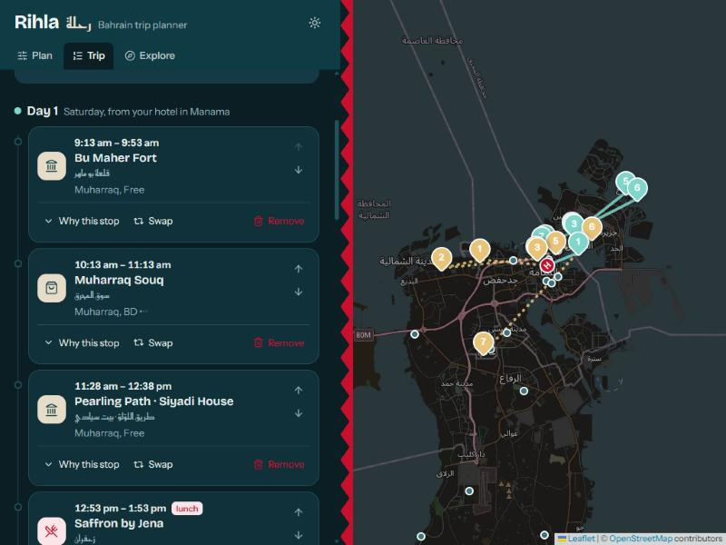

| Phone | How it decided | Why this stop and Swap |
| --- | --- | --- |
| 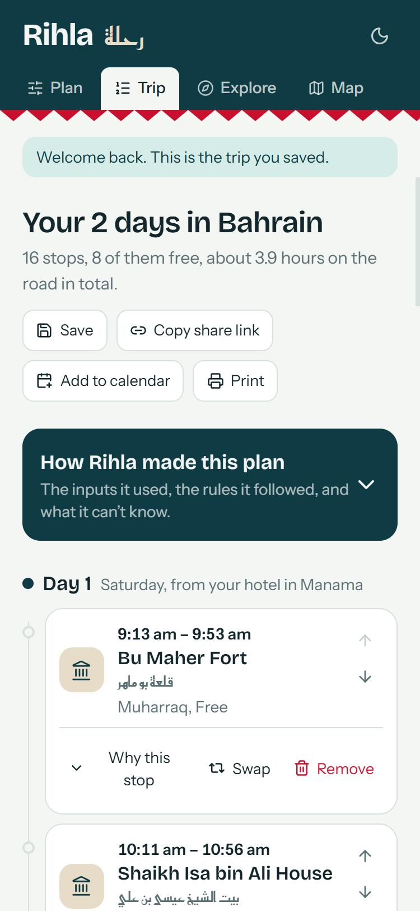 |  |  |
| 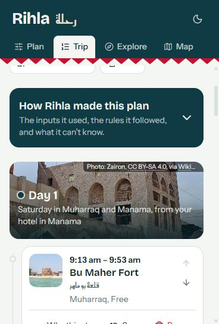 | 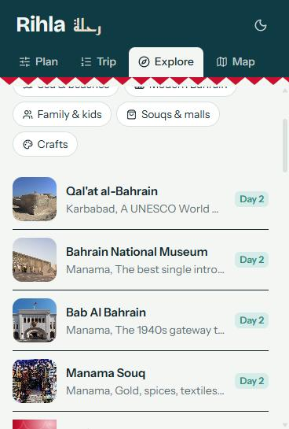 | 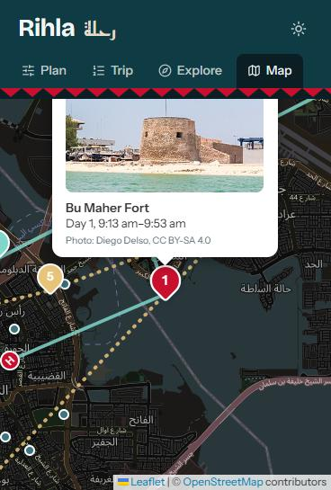 |
| 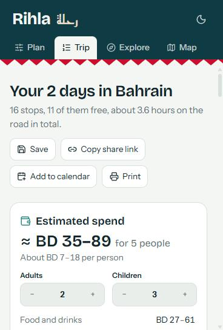 | 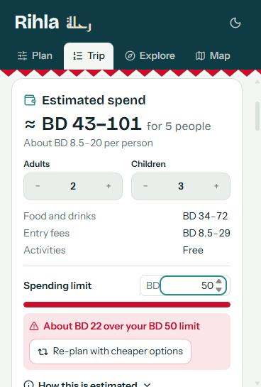 | 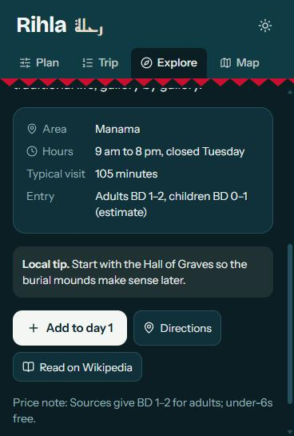 |
| 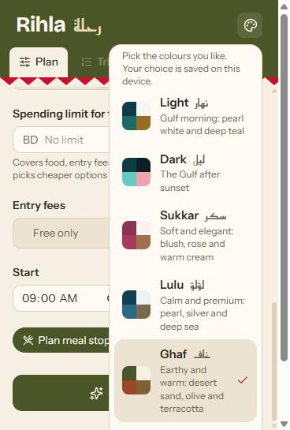 | 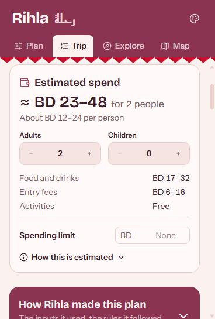 | 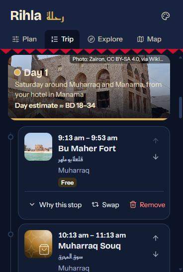 |

## Features

- **Plain-language input.** Type something like *"weekend with my kids, history, beaches, cheap please"*. Rihla shows what it understood and which words it understood it from, e.g. *Low budget from "cheap"*. You can then correct anything in the settings.
- **A real planner, not a fixed list.** It scores 30 hand-picked places against your interests, budget, pace, start day and hours. It skips places that are closed that day, keeps each day in one part of the island, reserves breakfast, lunch and dinner slots for food stops, and times outdoor spots for the late-afternoon light.
- **Explainable by design.** Every stop has a *Why this stop* list, such as *Matches Heritage, Crafts* or *10 min drive from the last stop*. The *How Rihla made this plan* panel shows the inputs, the six rules, the places it considered but left out (such as *Beit Al Quran: closed on Saturdays*), and what it can't know.
- **Edit and it re-times itself.** Move stops up or down, remove them, or swap one for a nearby alternative that fits the same time slot. If an edit breaks something, such as arriving after closing, you get a warning instead of a silent fix.
- **Live map.** OpenStreetMap with numbered pins and a route line for each day. Clicking a pin or a stop flies the map to it.
- **Explore 30 places.** Search and filter by interest. Each place has hours, typical visit length, entry cost, a local tip, its Arabic name and a directions link.
- **Keep and share.** Save the trip on your device, copy a share link (the whole trip is encoded in the URL, with no account or server), add it to your calendar as an `.ics` file, or print it.
- **Group size and spending estimates.** Set adults and children, here or in plain words ("2 adults and 3 kids", "family of 5"). Every stop shows an estimate such as *≈ BD 7.5–15 for 5 people, lunch*. Every day and the whole trip get a total, split into food, entry fees and activities. The figures use each place's real entry fees (adult and child), a typical meal spend per adult for that place and meal, and the cheapest common ticket for activities like karting. All of them are labelled as estimates.
- **Spending limit.** Set an optional limit for the whole trip, or write "under 60 BD". Rihla re-plans with a growing penalty on cost per person until the estimate fits, and says how many times it re-planned. If even the cheapest plan is over, it tells you honestly, rather than hiding it.
- **Checked data, with sources.** Every place records where its facts were checked and when. Facts that sources disagree on are marked approximate, and that label shows in the app. See [`docs/DATA-SOURCES.md`](docs/DATA-SOURCES.md).
- **Real photos, credited.** 22 places show a freely licensed photo from Wikimedia Commons. It appears as the hero image in Explore, a cover for each day of the trip, thumbnails on stops, and in map popups. Every large photo carries an author, licence and source credit. The other 8 places get an illustrated tile with an eight-point star lattice in the colour of their category. Images are lazy-loaded and fall back to the illustration if one fails to load.
- **Six colour themes.** Light and Dark, plus four themes with a Bahraini mood: **Sukkar** (سكر, blush, rose and warm cream), **Lulu** (لؤلؤ, pearl, silver and deep sea), **Ghaf** (غاف, desert sand, olive and terracotta) and **Nokhatha** (نوخذة, a dhow captain's navy, brass and gold). Each is a complete token set, covering the page, cards, text, accent, header, map tiles, route and pin colours, and photo overlays. Every theme passes WCAG AA contrast (`npm run contrast`). The picker shows a swatch for each, and your choice is saved on the device.
- **Made for Bahrain.** Bilingual place names, the serrated edge from the Bahraini flag as the signature detail, and a mobile layout with a full-screen map tab.

## How it meets the brief

| Brief | What was done |
| --- | --- |
| Use Claude to create an app | The whole app (idea, design system, planning engine, UI, tests and this README) was built with Claude in Claude Code. |
| Publish the code | Public GitHub repository (link below). |
| Share the link in the Blog Page | Live site on GitHub Pages (link below). A ready-to-paste blog paragraph and Teams post are in [`docs/BLOG.md`](docs/BLOG.md). |
| AI Literacy theme | The app treats planning as **inputs → rules → output** and shows all three. It also lists what the system *can't* know (live traffic, today's exact hours, your mood). That is the critical-thinking point from the course's "inputs and outputs" activity. |

**Live app:** https://potatos-119.github.io/rihla/
**Code:** https://github.com/Potatos-119/rihla

## How the planner works

1. **Inputs:** days, first weekday, start and end time, interests, pace, budget, kids, and meals. These come from the form or from the sentence parser in `src/lib/parse.ts`.
2. **Score** each place: +3 per matching interest, plus its visitor rating, plus a bonus for free places on a tight budget.
3. **Filter** out places that are closed that weekday, over budget, would close before you leave, or would run past your day.
4. **Penalise** drive time (an estimate from straight-line distance × 1.35 at about 38 km/h, plus parking) and crossing to another part of the island.
5. **Slots:** breakfast, lunch and dinner go to food places; outdoor sunset spots get a bonus between 4 and 6 pm.
6. **Greedy loop:** take the best-scoring stop, move the clock forward, and repeat until the pace limit is reached or the day ends.

It runs entirely in the browser, with no API key or server. That keeps it free to host, fast, and private, and makes every decision traceable. This is a deliberate AI-literacy choice: the "intelligence" here is transparent rules over curated data, and the app says so.

## Data check (26 November 2026)

All 30 places were checked against official listings (Bahrain Authority for Culture & Antiquities, bahrain.com, the Pearling Path and Bahrain International Circuit sites), Wikipedia, and recent reviews. Map pins were cross-checked against OpenStreetMap and Wikipedia coordinates. What changed:

- **Map pins moved**: Bahrain World Trade Center (it was 2.7 km off), Marassi Beach (3.2 km), Al Areen Wildlife Park (7 km), A'ali burial mounds (1.3 km), Beit Al Quran, Bahrain National Museum, Haji's Café, Saffron by Jena, Bahrain Bay, Amwaj Lagoon and the Circuit.
- **Hours and closing days corrected**: National Museum (9 am–8 pm, closed Tuesdays); Pearling Path / Siyadi House (10 am–6 pm, closed Tuesdays); Bu Maher Fort (closed Tuesdays); Beit Al Quran (open Saturdays, mornings 9–12 plus 4–6 pm, closed Fridays); Barbar Temple (8 am–5 pm); Haji's Café (5:30 am–9 pm, now also lunch and dinner); Manama and Muharraq souqs (8:30 am–10 pm); A'ali pottery (closed Fridays); Shaikh Isa bin Ali House and Riffa Fort (shorter planning window, with a renovation notice).
- **Prices replaced with real figures**: entry fees for adults and children (for example National Museum BD 1–2, Arad Fort BD 1, Al Areen BD 1, Marassi Beach BD 2–4); typical meal spend per place and meal; and karting at the Circuit at BD 14 plus BD 1 registration.
- **Content fixed**: Riffa Fort's "terrace café" is the Saffron by Jena branch inside the fort; Arad Fort is no longer listed as free.
- **Still approximate (shown as such in the app)**: café and restaurant spend, beach and wildlife-park prices, and opening hours where official sources conflict.

## Photos

`scripts/fetch-images.mjs` runs once, ahead of time. It reads each place's Wikipedia lead image (or a hand-picked Commons file), keeps it only if the licence is free (CC BY, CC BY-SA, CC0, public domain), and writes the URL, author, licence and source page to `src/data/images.json`. The app never calls an API while you use it and needs no key, so nothing can leak from the public site. Re-run it with:

```bash
node scripts/fetch-images.mjs
```

## Tech

React 19 · TypeScript · Vite · Tailwind CSS v4 · Leaflet / react-leaflet with OpenStreetMap tiles · lucide icons · self-hosted fonts (Bricolage Grotesque, Instrument Sans, Reem Kufi).

```
src/
  data/places.ts        30 curated places: coordinates, hours, cost, tags, tips, Arabic names
  data/images.json      photo URL, author, licence and source per place (generated)
  lib/planner.ts        scoring, scheduling, re-timing, swap suggestions, explanations
  lib/parse.ts          plain-language request → settings, with evidence
  lib/cost.ts           group size, per-stop, per-day and trip estimates
  lib/share.ts          save, share links, calendar export
  lib/themes.ts         the six colour themes as token sets
  components/           PlanForm, TripView, Explore, MapView, small UI parts
scripts/sample-plans.ts prints sample itineraries for checking planner changes
```

## Run it locally

Requires Node.js 20 or newer.

```bash
npm install
npm run dev        # http://localhost:5173
npm run build      # production build in dist/
npm run sample     # print sample itineraries and cost estimates
npm run sources    # regenerate docs/DATA-SOURCES.md from the data
npm run check      # check that a spending limit never makes a plan dearer
npm run contrast   # check every colour theme against WCAG AA
```

## Limits

Opening hours and prices were checked on 26 November 2026, but they change. Where sources disagree, the app says so. Cost figures are estimates, not quotes: they leave out transport, shopping and tips. Drive times ignore live traffic. The text parser uses keyword matching, so it shows exactly what it picked up, and anything it missed can be fixed in the settings.

---

Map data © OpenStreetMap contributors. Photos from Wikimedia Commons; each photo's author and licence are shown on the photo in the app and stored in `src/data/images.json`. Made by a Bahrain Polytechnic student with Claude.
